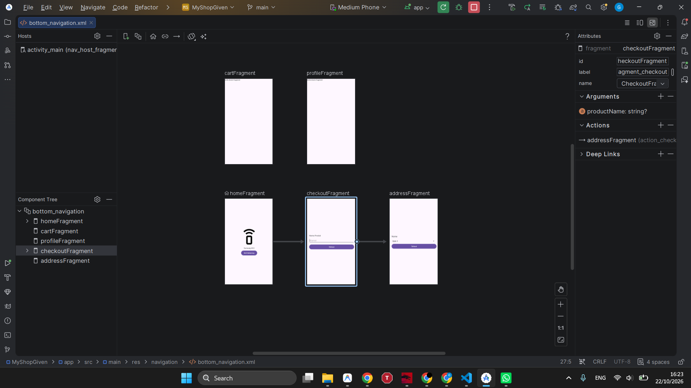
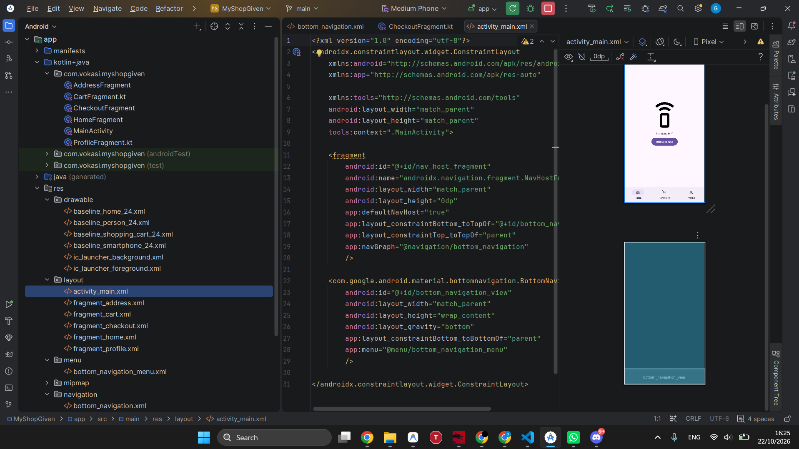
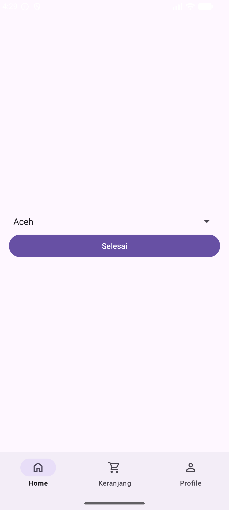
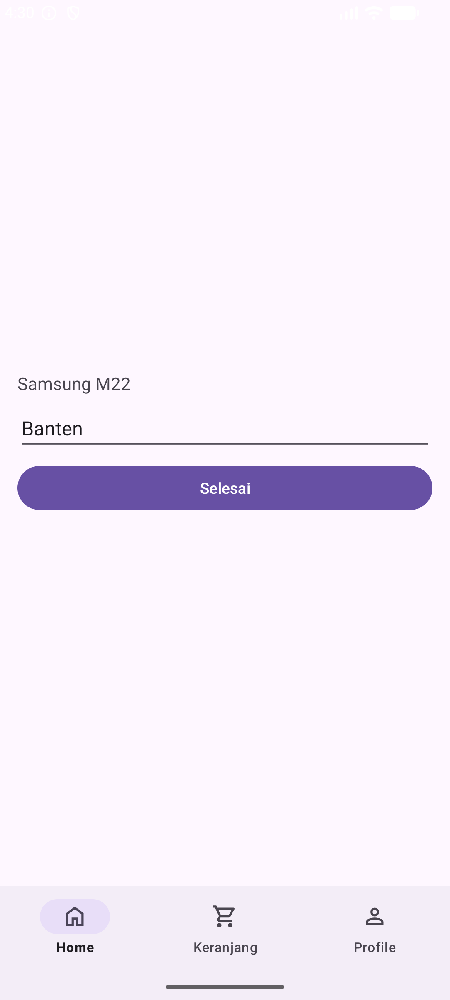

# MyShopGiven

Aplikasi Android e-commerce sederhana berbasis **Single-Activity Architecture** yang menerapkan **Jetpack Navigation Component**, **BottomNavigationView**, **Fragment**, **Safe Args**, dan **SavedStateHandle**.

Proyek ini disusun untuk memenuhi tugas **Praktikum Pemrograman Perangkat Bergerak Pertemuan 8**, Program Studi D-IV Teknologi Rekayasa Perangkat Lunak, Departemen Teknik Elektro dan Informatika, Sekolah Vokasi, Universitas Gadjah Mada.

---

## Informasi Mahasiswa
- **Nama**: Given Gerald Chandra
- **NIM**: 25/560235/SV/26410
- **Kelas**: PL3B2 [Rabu]
- **Dosen Pengampu**: Dr. Irkham Huda, S.Kom., M.Cs.
- **Dokumen Laporan PDF**: [560235_GivenGeraldChandra_PPPBD_Pertemuan_8.pdf](docs/560235_GivenGeraldChandra_PPPBD_Pertemuan_8.pdf)

---

## Fitur dan Arsitektur Aplikasi

1. **Single-Activity Navigation**:
   - `MainActivity` berfungsi sebagai kontainer utama dengan elemen `FragmentContainerView` (`NavHostFragment`) dan `BottomNavigationView`.
   - Bilah navigasi bawah otomatis terhubung ke `NavController` menggunakan fungsi `setupWithNavController()`.
2. **Bottom Navigation**:
   - Tab **Home** (`HomeFragment` sebagai *startDestination*).
   - Tab **Keranjang** (`CartFragment`).
   - Tab **Profile** (`ProfileFragment`).
3. **Safe Args Parameter Passing**:
   - Tombol "Beli Sekarang" pada `HomeFragment` memicu navigasi menuju `CheckoutFragment`.
   - Nama produk ("Samsung M22") dikirimkan secara *type-safe* menggunakan kelas otomatis `HomeFragmentDirections`.
   - Nilai diterima dan diekstrak pada `CheckoutFragment` melalui delegasi `by navArgs()`.
4. **Two-Way Communication via SavedStateHandle**:
   - Kolom alamat pada `CheckoutFragment` membuka `AddressFragment` saat diklik.
   - Pilihan provinsi dipilih menggunakan komponen `Spinner` yang memuat data array dari `strings.xml`.
   - Data provinsi dikembalikan ke `CheckoutFragment` lewat `previousBackStackEntry.savedStateHandle.set("address", ...)` lalu memanggil `navigateUp()`.
   - `CheckoutFragment` menyimak kembalian data secara reaktif menggunakan `LiveData` observer dan mengisikannya ke kolom alamat.
5. **Aset Visual & Vektor**:
   - Seluruh ikon navigasi dan ilustrasi smartphone menggunakan aset vektor bawaan Android Studio yang di-*rename* (`baseline_home_24.xml`, `baseline_shopping_cart_24.xml`, `baseline_person_24.xml`, `baseline_smartphone_24.xml`).

---

## Diagram Alur Navigasi (*Navigation Graph*)

Alur antarmuka dirancang pada file `res/navigation/bottom_navigation.xml`:



*Gambar 1: Visualisasi Navigation Graph pada editor Android Studio.*



*Gambar 2: Tampilan jendela kerja Android Studio memperlihatkan struktur proyek.*

---

## Dokumentasi Pengujian Aplikasi (Emulator)

Pengujian alur belanja dilakukan langsung pada emulator *Medium Phone* (API level 36):

| 1. Layar Home Aktif | 2. Checkout (Safe Args) | 3. Spinner Pilihan Alamat |
| :---: | :---: | :---: |
|  |  |  |
| Produk Samsung M22 dan bilah Bottom Navigation | Nama produk terisi otomatis via Safe Args | Pilihan provinsi pada Dropdown Spinner |

| 4. Hasil Alamat di Checkout | 5. Transaksi Selesai & Kembali |
| :---: | :---: |
|  |  |
| Alamat terisi via `SavedStateHandle` | Tombol Selesai kembali ke layar awal |

---

## Spesifikasi Teknis Lingkungan Pengembangan
- **Android Studio**: Ladybug / Narwhal
- **Gradle Version**: 8.13
- **Gradle JDK**: Java 21 (`jbr-21`)
- **Compile SDK**: 36
- **Target SDK**: 36
- **Minimum SDK**: 24
- **Language**: Kotlin 2.0+
- **View Binding**: Enabled
- **Navigation Version**: 2.10.2 (`androidx.navigation.safeargs.kotlin`)

---

## Struktur Direktori Utama

```text
MyShopGiven/
├── app/
│   ├── src/main/
│   │   ├── java/com/vokasi/myshopgiven/
│   │   │   ├── MainActivity.kt
│   │   │   ├── HomeFragment.kt
│   │   │   ├── CartFragment.kt
│   │   │   ├── ProfileFragment.kt
│   │   │   ├── CheckoutFragment.kt
│   │   │   └── AddressFragment.kt
│   │   └── res/
│   │       ├── drawable/
│   │       │   ├── baseline_home_24.xml
│   │       │   ├── baseline_shopping_cart_24.xml
│   │       │   ├── baseline_person_24.xml
│   │       │   └── baseline_smartphone_24.xml
│   │       ├── layout/
│   │       │   ├── activity_main.xml
│   │       │   ├── fragment_home.xml
│   │       │   ├── fragment_cart.xml
│   │       │   ├── fragment_profile.xml
│   │       │   ├── fragment_checkout.xml
│   │       │   └── fragment_address.xml
│   │       ├── menu/
│   │       │   └── bottom_navigation_menu.xml
│   │       ├── navigation/
│   │       │   └── bottom_navigation.xml
│   │       └── values/
│   │           └── strings.xml
│   └── build.gradle.kts
├── docs/
│   ├── 560235_GivenGeraldChandra_PPPBD_Pertemuan_8.pdf
│   └── screenshots/
├── build.gradle.kts
├── settings.gradle.kts
└── README.md
```
